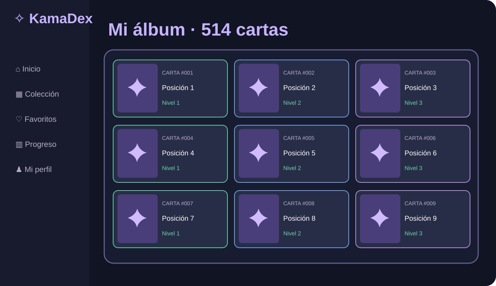
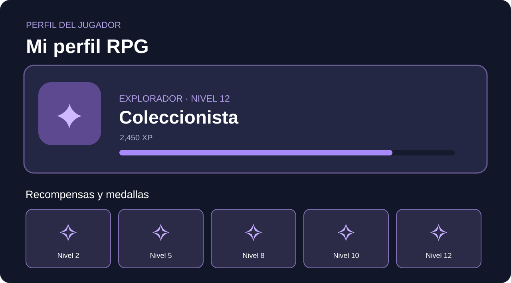

# KamaDex — Colección privada de cartas (18+)


### Vista del álbum y perfil RPG





Una aplicación de álbum coleccionable con **514 fichas**, tarjetas ilustradas, seguimiento de realización, XP según dificultad, favoritos, perfil RPG y estadísticas. Diseñada para personas adultas.

## Funciones

- Catálogo de **514 cartas** ordenadas de fácil a experto (clasificación provisional).
- Vista álbum, cuadrícula, búsqueda, filtros y selección aleatoria.
- Marcar/desmarcar una carta, favoritos y notas privadas.
- **XP por primera vez:** Fácil 70; Intermedio 120; Avanzado 195; Experto 295. Se evita duplicar recompensas al desmarcar.
- Rango de jugador, medallas, logros por cantidad, animación de nivel y perfil personalizable.
- Exportación/restauración con cifrado **AES-GCM y PBKDF2** (requiere HTTPS o localhost).
- Diseño oscuro/claro adaptable a teléfono y escritorio.

## Ejecutar localmente

```bash
python -m http.server 8000
```

Abre **http://localhost:8000**. No hay dependencias de compilación. `index.html` utiliza `src/app.js`, `src/styles.css` y `src/catalog.js` como archivos independientes.

## Publicar con GitHub Pages

En **Settings → Pages → Build and deployment**, elige `Deploy from a branch`, `main`, carpeta `/ (root)` y guarda. El sitio previsto será `https://marcosadelacruz.github.io/KamaDex/` después de que GitHub complete la publicación.

## Imágenes y derechos

`assets/illustrations-manifest.json` contiene 514 enlaces a las ilustraciones del proyecto de referencia. **Los 514 PNG no se encuentran almacenados en este repositorio**: se cargan desde el repositorio original en línea. El script `tools/download_images.py` permite preparar una carpeta local de imágenes si tienes autorización y el alojamiento destino admite este material. Las imágenes y marcas de terceros **no** se relicencian mediante la licencia MIT del código.

- Datos e ilustraciones procedentes de [random-sex-position](https://github.com/raminr77/random-sex-position) y [SexPositions.Club](https://sexpositions.club/).
- El titular de KamaDex indicó contar con autorización del propietario de las ilustraciones para utilizarlas.
- La escala de dificultad es una aproximación de diseño y **no** constituye una valoración médica ni una garantía de seguridad.

## Privacidad

El progreso se guarda en el navegador. No se transmite a GitHub. El navegador no cifra automáticamente el almacenamiento local; las copias exportadas sí están cifradas.

## Licencia

Código de KamaDex: MIT. Conservar avisos del proyecto original y las condiciones específicas del material de terceros.

